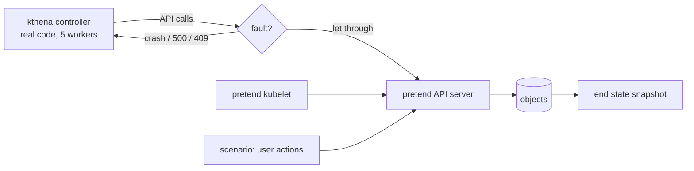

# How faultlab works

faultlab runs kthena's **real controller code** against a **pretend
Kubernetes cluster**, breaks things on purpose while the controller works,
and checks that the controller still ends up in the right place.



## 1. The pretend cluster (`internal/world`)

client-go ships a fake clientset for unit tests. It stores objects in memory
but skips most of what a real API server does, so code that depends on those
rules is never tested. faultlab keeps the fake clientset (the controller still
calls `client.CoreV1().Pods(ns).Create(...)`), but answers every call itself,
with the rules a real API server applies:

| Rule | Plain fake clientset | faultlab |
| --- | --- | --- |
| `resourceVersion` changes on every write; an update with an old one gets **409 Conflict** | never | yes |
| `uid` set on create; delete preconditions check it | never | yes |
| `generation` +1 when the spec changes | never | yes |
| status subresource: `Update` can't change status, `UpdateStatus` can't change anything else | no | yes |
| an update that changes nothing is not stored and sends no watch event | stored | yes |
| delete with finalizers only sets `deletionTimestamp` | deletes at once | yes |
| deleting a running pod waits for the kubelet (graceful termination) | deletes at once | yes |
| garbage collection through `ownerReferences` | none | yes |
| CRD default values (`+kubebuilder:default`) | none | yes, from the CRD file |
| validating webhooks | none | yes, kthena's real webhook handler |
| watch-list (how informers start since client-go 1.35) | partly | yes |

The **kubelet** is pretend too (`kubelet.go`): it starts pods, reports them
Ready, restarts containers whose image changed, and finishes graceful
deletions. It only acts when the controller is idle, because a real kubelet is
much slower than a controller.

Every call is written to a **log** (`log.go`): who (controller-1, user,
kubelet, gc), what (create pods default/demo-0-decode-0-0) and the result
(created, updated, no change, deleting, deleted, or the error). The log is
what you read when a check fails.

## 2. One run (`internal/lab/run.go`)

```text
setup   the scenario creates the starting objects; the controller settles them
change  the fault is armed; the scenario makes its change (scale, new image, ...)
settle  wait until the controller is idle and the kubelet has nothing to do
crash?  if the fault killed the process: start a NEW controller (empty memory)
        on the same cluster, and settle again
then    (some scenarios) a second change, e.g. a rollback
snapshot  take the end state
resync  queue every object once more; record the writes
restart replace the process with a new one; record its writes
```

Each controller process gets its own connection (`conn.go`). A fault belongs
to a connection, so when it kills one process, nothing that process left
running can still write, and its replacement works normally.

## 3. Knowing when the controller is done

A controller has no "I'm finished" signal. faultlab looks inside it
(`internal/lab/probe.go`): it swaps the controller's work queue for an
instrumented one and wraps its sync function. Both are unexported fields, so
this uses Go reflection; if kthena renames them, faultlab stops with an error
that names the field.

The controller counts as **idle** when, for 150 ms in a row:

- no key is queued and no reconcile is running,
- no requeue is due in the next 3 s (kthena requeues after 1 s in many places),
- nobody has written anything.

If that doesn't happen within 60 s, the run reports **did not settle** with
what the controller kept doing (for example "12x update modelservings/status").

## 4. The checks (`internal/checks`)

None of the checks needs hand-written expected values. Each compares the run
with a rule:

| Check | Fault | Rule |
| --- | --- | --- |
| clean | none | the controller settles, and two runs end in the same state |
| resync | none | once settled, one more reconcile of everything writes nothing |
| restart | none | once settled, a new process writes nothing and changes nothing |
| crash | process dies just before write *k*, for every *k* | a new process reaches the same end state as the clean run |
| api-error | write *k* fails once with HTTP 500, for every *k* | the controller retries and reaches the same end state |
| conflict | first update of each object gets 409 after another writer changed it | same end state |
| interrupt | the scenario's second change arrives just before write *k*, for every *k* | same end state as making it after the first change finished |

*k* runs over every write the controller made in the clean run, so the crash
check tries every point where a real crash could leave half-done work.

Writes that change nothing are reported as **warn** (wasted API calls), writes
that change state on a settled cluster as **fail**.

## 5. Each run is its own process

`faultlab run` starts every run as a child process (`faultlab case ...`):

- a **panic** in the controller kills only that child, and becomes a finding
  with its stack trace instead of stopping faultlab;
- the child runs with `KUBE_CACHE_MUTATION_DETECTOR=true`, so a controller
  that changes an object it got from an informer's cache panics, and that
  becomes a finding too;
- runs share no global state, so 8 can run at once.

## 6. Avoiding false alarms

A false alarm sent to kthena costs trust, so:

- the end state is cleaned before comparing: uids, resourceVersions,
  timestamps and faultlab's own annotations differ between any two runs;
- the scenario's and the kubelet's own writes are never counted or faulted;
- every failing case is run 2 more times: **fail** means it failed every time,
  **flaky** means only sometimes (timing-dependent: real, but look closer);
- the clean check runs every scenario twice; if two runs without faults end
  differently, every comparison for that scenario is suspect.

Still: every finding is a suspect until the log shows the controller made the
bad write, and you can reproduce it with `faultlab trace`.

## 7. Limits

- Pods don't run anything: no containers, probes or real timing.
- The scheduler and Volcano are not simulated: every pod is placed at once,
  and PodGroups don't gate anything.
- Only what the API server rules above cover is realistic. Admission webhooks
  other than kthena's ModelServing validator, defaulting of built-in types,
  and server-side apply are not modelled.
- Informers are never slower than the real ones; stale-cache and missed-event
  faults (what Sieve injects) are not covered yet.
- A real cluster (kind) is still needed to prove a finding before filing it.
